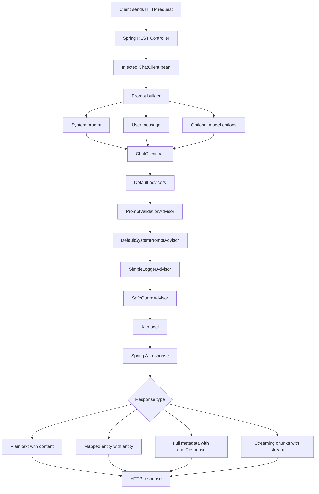

# Gen AI Spring Boot

A Spring Boot REST API for experimenting with generative AI chat integrations through Spring AI and a direct OpenAI HTTP client.

The application currently supports:

- Summarizing text with a Spring AI `ChatClient`
- Summarizing text with a direct Apache HTTP client call to OpenAI
- Drafting professional emails from user input
- Applying token probability controls through an Ollama-backed endpoint
- Returning model output wrapped in a JSON response
- Inspecting AI response details and token usage metadata
- Streaming AI responses chunk by chunk
- Returning consistent JSON error responses through global exception handling
- Learning prompting step by step through dedicated prompting endpoints
- Running local model experiments with Ollama / Docker model endpoints

## Tech Stack

- Java 25
- Spring Boot 4.1.0
- Spring AI 2.0.0
- Maven
- Apache HttpClient 5
- OpenAI-compatible chat APIs
- Ollama

## Project Structure

The main Spring Boot application class is `GenAiSbApplication`.

The `config` package contains `AppConfig`, which creates separate Spring AI chat clients for OpenAI and Ollama models.

The `advisor` package contains custom Spring AI advisors used by the chat clients.

The `controller` package contains the REST API controllers for summarization, email drafting, Ollama token probability options, JSON-wrapped responses, AI response details, and streaming responses.

The `prompting` package contains a dedicated controller for learning prompting step by step.

The `client` package contains `OpenAIClientService`, which demonstrates calling the OpenAI chat completions API directly with Apache HttpClient.

The `exception` package contains the custom `OpenAIChatException`, global exception handling, and the common API error response shape.

The `hugging-face` folder contains a helper script for testing Hugging Face summarization, and the `ollama` folder contains a Mistral model manifest reference.

## Spring AI Concepts Used

This project is mainly a Spring AI practice project. It shows different ways to send prompts to AI models, configure model behavior, protect requests with advisors, and inspect model responses.

### What Is AI In This Project?

AI means a language model that can understand text input and generate text output.

In this project, the Spring Boot application does not generate the answer by itself. It sends the user message to an AI model through Spring AI, then returns the model response through a REST endpoint.

The project uses two AI integration styles:

- Spring AI integration through `ChatClient`
- Direct HTTP integration through `OpenAIClientService`

Spring AI gives a higher-level Java API for working with AI models. Instead of manually building every HTTP request, the application can use `ChatClient` to build prompts, apply advisors, set model options, and map responses.

The direct HTTP client exists for learning purposes. It shows what a lower-level OpenAI chat completions call looks like when created manually with Apache HttpClient.

### Request Flow Diagram

The diagram below shows how a request moves through the application when an endpoint uses Spring AI.



Step by step:

- The client sends a request to one of the REST endpoints.
- The controller uses the injected `ChatClient` bean.
- The prompt is built with optional system instructions, user input, and model options.
- Default advisors run before or around the model call.
- `PromptValidationAdvisor` validates the user prompt before the model call.
- `DefaultSystemPromptAdvisor` adds a shared system prompt without changing endpoint-specific system prompts.
- `SimpleLoggerAdvisor` logs chat activity.
- `SafeGuardAdvisor` blocks restricted words such as `password` and `username`.
- The request is sent to the configured AI model.
- The controller chooses how to return the result: plain text, mapped entity, or detailed metadata.

### ChatClient

`ChatClient` is the main Spring AI API used by the controllers.

The project defines two named `ChatClient` beans in `AppConfig`:

- `openAIChatClient` uses `OpenAiChatModel`
- `ollamaAIChatClient` uses `OllamaChatModel`

Controllers inject the correct client with `@Qualifier`. The OpenAI controller uses `openAIChatClient`, while the Ollama controller uses `ollamaAIChatClient`.

The common Spring AI call flow in this project is:

- `chatClient.prompt()` starts a new prompt request
- `.system(...)` adds system instructions for the model
- `.user(...)` adds the user message
- `.options(...)` applies request-level model options when needed
- `.call()` sends the request to the model
- `.content()`, `.entity(...)`, `.chatResponse()`, or `.stream()` controls how the response is returned

### Prompt Types

A prompt is the instruction or message sent to the AI model.

This project uses these prompt types:

- System prompt
- User prompt

A system prompt tells the model how it should behave. It is usually written by the application developer and is not the user's direct question. For example, the email endpoint uses a system prompt to tell the model to write clear, polite, concise, and formal emails.

A user prompt is the actual message from the API caller. In this project, it comes from `@RequestBody` and is passed into `.user(...)`.

Spring AI combines these messages into one chat request. The model reads the system prompt as behavior guidance and the user prompt as the task to answer.

Other common prompt/message types in AI chat systems are assistant messages and tool messages. Assistant messages represent previous AI replies in a conversation. Tool messages represent results returned from external tools. This project mainly demonstrates system and user messages.

### Prompting Step By Step

The `PromptingController` in the `prompting` package is dedicated to learning prompting from simple to more structured examples.

All prompting examples use the configured Ollama `ChatClient`.

#### Step 1: User Prompt

Endpoint:

`POST /v1/api/prompting/step-1-user-prompt`

This sends only the user message to the model with `.user(...)`.

Use this when you want the simplest possible prompt.

Example:

```bash
curl -X POST http://localhost:8083/v1/api/prompting/step-1-user-prompt \
  -H "Content-Type: application/json" \
  -d '{"message":"What is Spring AI?"}'
```

#### Step 2: System Prompt

Endpoint:

`POST /v1/api/prompting/step-2-system-prompt`

This combines `.system(...)` and `.user(...)`.

The system prompt tells the model to behave like a patient Spring AI teacher. The user prompt provides the actual question.

Example:

```bash
curl -X POST http://localhost:8083/v1/api/prompting/step-2-system-prompt \
  -H "Content-Type: application/json" \
  -d '{"message":"Explain ChatClient."}'
```

#### Step 3: Prompt Template

Endpoint:

`POST /v1/api/prompting/step-3-template-prompt`

This uses `PromptTemplate` with variables:

- `topic`
- `audience`
- `tone`

Prompt templates are useful when the prompt structure is fixed but the values change.

Example:

```bash
curl -X POST http://localhost:8083/v1/api/prompting/step-3-template-prompt \
  -H "Content-Type: application/json" \
  -d '{"topic":"Spring AI advisors","audience":"beginner Java developer","tone":"friendly"}'
```

#### Step 4: Few-Shot Prompt

Endpoint:

`POST /v1/api/prompting/step-4-few-shot-prompt`

This provides examples in the system prompt before asking the model to answer the user input.

Few-shot prompting is useful when you want the model to follow a style or pattern.

Example:

```bash
curl -X POST http://localhost:8083/v1/api/prompting/step-4-few-shot-prompt \
  -H "Content-Type: application/json" \
  -d '{"message":"PromptTemplate renders reusable prompts."}'
```

#### Step 5: Output Format Prompt

Endpoint:

`POST /v1/api/prompting/step-5-output-format-prompt`

This tells the model exactly how to structure the response.

Output-format prompting is useful when you want consistent sections, labels, or formatting.

Example:

```bash
curl -X POST http://localhost:8083/v1/api/prompting/step-5-output-format-prompt \
  -H "Content-Type: application/json" \
  -d '{"message":"Explain topK and topP."}'
```

### Prompting Techniques

Prompting techniques are ways to design the message so the AI response fits the end user's need.

The `PromptingTechniqueController` demonstrates six common prompting techniques.

#### Role Prompting

Endpoint:

`POST /v1/api/prompting/techniques/role`

Role prompting tells the model who it should act as. In this project, the model is asked to act as a Java teacher.

Example:

```bash
curl -X POST http://localhost:8083/v1/api/prompting/techniques/role \
  -H "Content-Type: application/json" \
  -d '{"message":"Explain dependency injection."}'
```

#### Few-Shot Prompting

Endpoint:

`POST /v1/api/prompting/techniques/few-shot`

Few-shot prompting gives examples before asking the model to answer. This helps the model follow the same style or pattern.

Example:

```bash
curl -X POST http://localhost:8083/v1/api/prompting/techniques/few-shot \
  -H "Content-Type: application/json" \
  -d '{"message":"Advisors intercept Spring AI requests."}'
```

#### Output Format Prompting

Endpoint:

`POST /v1/api/prompting/techniques/output-format`

Output format prompting asks the model to return a specific structure, such as sections, bullet points, JSON, or a table.

Example:

```bash
curl -X POST http://localhost:8083/v1/api/prompting/techniques/output-format \
  -H "Content-Type: application/json" \
  -d '{"message":"Explain Spring AI ChatClient."}'
```

#### Constraint Prompting

Endpoint:

`POST /v1/api/prompting/techniques/constraint`

Constraint prompting adds limits, such as word count, tone, length, or what details to include.

Example:

```bash
curl -X POST http://localhost:8083/v1/api/prompting/techniques/constraint \
  -H "Content-Type: application/json" \
  -d '{"message":"Explain Ollama in Spring AI."}'
```

#### Audience Prompting

Endpoint:

`POST /v1/api/prompting/techniques/audience`

Audience prompting tells the model who the answer is for. This helps the model choose the right depth and language.

Example:

```bash
curl -X POST http://localhost:8083/v1/api/prompting/techniques/audience \
  -H "Content-Type: application/json" \
  -d '{"message":"Explain topK and topP."}'
```

#### Step-By-Step Prompting

Endpoint:

`POST /v1/api/prompting/techniques/step-by-step`

Step-by-step prompting asks the model to explain in an ordered sequence.

Example:

```bash
curl -X POST http://localhost:8083/v1/api/prompting/techniques/step-by-step \
  -H "Content-Type: application/json" \
  -d '{"message":"Explain how a Spring AI advisor works."}'
```

### Advisor Types

Spring AI advisors are reusable components that can intercept or decorate chat requests and responses. They are useful for adding cross-cutting behavior without repeating logic in every controller method.

This project configures four advisors in `AppConfig`:

- `PromptValidationAdvisor`
- `DefaultSystemPromptAdvisor`
- `SimpleLoggerAdvisor`
- `SafeGuardAdvisor`

All advisors are registered as default advisors on the OpenAI and Ollama `ChatClient` beans. This means every request made through those clients goes through the advisors automatically.

`PromptValidationAdvisor` is a custom advisor created in this project. It validates the user prompt before the model call. It checks that the message is not empty and that the message is not longer than `120` approximate tokens.

If validation fails, `PromptValidationAdvisor` does not call the AI model. Instead, it returns a normal `ChatClientResponse` with a validation failure message. This is useful because the controller can still return a response, but the expensive or unsafe model call is skipped.

`DefaultSystemPromptAdvisor` is a custom advisor created in this project. It adds a common system prompt to every Spring AI request. This is useful when you want all model calls to follow a shared behavior, such as being helpful, clear, and beginner friendly.

The important detail is that this advisor does not change the existing system prompts in the controller methods. For example, the email endpoint still keeps its own email-writing system prompt. The advisor adds one more `SystemMessage` before the existing messages.

`SimpleLoggerAdvisor` logs chat request and response activity. The application enables advisor logging in `application.yaml` with `org.springframework.ai.chat.client.advisor: DEBUG`.

`SafeGuardAdvisor` blocks requests that contain restricted words. In this project, the restricted words are `password` and `username`. If a request contains one of those words, the advisor returns `Your request contains restricted information.` instead of sending the prompt normally.

Common advisor use cases include:

- Logging advisor: records prompt and response activity for debugging.
- Safety advisor: blocks or changes unsafe or restricted input.
- Memory advisor: adds previous conversation context to the prompt.
- Retrieval advisor: adds relevant external data before the model answers.
- Custom advisor: applies application-specific rules before or after a model call.

This project currently implements prompt validation, shared system prompt enrichment, logging, and safeguard behavior.

Advisors are best for prompt and response pipeline behavior. Examples include validation before the model call, logging, memory, retrieval, and safety checks.

Global exception handling is different. It is best for converting Java exceptions into clean HTTP error responses. If the AI model is down, a JSON request body is invalid, or the server throws an unexpected exception, `GlobalExceptionHandler` returns a consistent JSON error response instead of the default Spring Boot error body.

### Custom Prompt Validation Advisor

`PromptValidationAdvisor` demonstrates how to create your own Spring AI advisor.

The custom advisor implements both `CallAdvisor` and `StreamAdvisor`.

`CallAdvisor` works with normal synchronous `.call()` requests.

`StreamAdvisor` works with streaming `.stream()` requests.

Implementing both is important because a project can call AI models in two different ways:

- Normal call: waits for the full response, then returns it.
- Streaming call: returns chunks of the response as the model generates them.

If an advisor only implements `CallAdvisor`, it validates normal requests but does not protect streaming requests. This project implements both so the same validation rule applies to both response styles.

The main method is `adviseCall(...)`. That method receives:

- `ChatClientRequest`: the current prompt request
- `CallAdvisorChain`: the remaining advisor/model chain

The streaming method is `adviseStream(...)`. That method receives:

- `ChatClientRequest`: the current prompt request
- `StreamAdvisorChain`: the remaining streaming advisor/model chain

The advisor reads the user message from `request.prompt().getUserMessage()`.

If the message is empty, it returns:

- `Prompt validation failed: message is required.`

If the message is longer than `120` approximate tokens, it returns:

- `Prompt validation failed: message is too long.`

If validation passes, it calls `chain.nextCall(request)`. That line is important because it tells Spring AI to continue to the next advisor and eventually to the AI model.

For streaming requests, validation passes by calling `chain.nextStream(request)`.

The advisor is registered in `AppConfig` as:

- `promptValidationAdvisor`

Then it is added to both `openAIChatClient` and `ollamaAIChatClient` through `defaultAdvisors(...)`.

The advisor order is:

- `PromptValidationAdvisor`
- `SimpleLoggerAdvisor`
- `SafeGuardAdvisor`
- AI model call

This means the application validates basic prompt shape first, then logs, then checks restricted words, then calls the model.

### Custom Default System Prompt Advisor

`DefaultSystemPromptAdvisor` demonstrates how to add shared model instructions globally.

The custom advisor implements both `CallAdvisor` and `StreamAdvisor`, so it works for normal `.call()` requests and streaming `.stream()` requests.

The advisor creates a new prompt by:

- Reading the existing prompt from `request.prompt()`
- Creating a new list of messages
- Adding a new `SystemMessage` with the shared instruction
- Adding all existing prompt messages after it
- Preserving the existing chat options with `prompt.getOptions()`
- Continuing with `chain.nextCall(updatedRequest)` or `chain.nextStream(updatedRequest)`

This means endpoint-specific system prompts are preserved.

For example, the email endpoint already has a system prompt that tells the model to draft professional emails. The advisor does not replace that prompt. It adds a shared system message before it.

The advisor is registered in `AppConfig` as:

- `defaultSystemPromptAdvisor`

The shared instruction currently says that the assistant is part of a Spring AI learning application and should keep responses helpful, clear, and beginner friendly.

The advisor order is:

- `PromptValidationAdvisor`
- `DefaultSystemPromptAdvisor`
- `SimpleLoggerAdvisor`
- `SafeGuardAdvisor`
- AI model call

This order means the app validates the user prompt first, adds the shared system instruction second, logs the enriched request third, then applies the safeguard check before the model call.

### Streaming Responses

The `/v1/api/ollama/chat/stream` endpoint demonstrates Spring AI streaming.

A normal `.call()` request waits until the model finishes the full answer. A `.stream()` request returns output gradually while the model is still generating.

This project returns streaming content with:

- `Flux<String>`
- `MediaType.TEXT_EVENT_STREAM_VALUE`
- `chatClient.prompt().user(...).stream().content()`

The endpoint accepts a JSON request body with a `message` field.

Example curl:

```bash
curl -N -X POST http://localhost:8083/v1/api/ollama/chat/stream \
  -H "Content-Type: application/json" \
  -H "Accept: text/event-stream" \
  -d '{"message":"Explain Spring AI streaming in simple words."}'
```

The `-N` option tells curl not to buffer the response, so streamed chunks appear as soon as they arrive.

Because `PromptValidationAdvisor` implements `StreamAdvisor`, the same custom validation also runs for this streaming endpoint.

Use streaming when:

- Building a chat UI where users should see text appear as the model generates it.
- Generating long answers, reports, explanations, summaries, or code.
- Using slower local models such as Ollama, where waiting for the full response can feel slow.
- Building voice, live assistant, or real-time experiences.
- Improving perceived speed, even when the total generation time is similar.

Avoid streaming when:

- The endpoint must return one complete JSON object.
- The response must be mapped with `.entity(...)`.
- The full AI response must be validated before the user sees it.
- The response is very short.
- The endpoint is mainly for backend-to-backend integration where a simple request/response is easier.

In this project:

- Use `/v1/api/ollama/chat/json-response` when you want a mapped Java entity response.
- Use `/v1/api/ollama/chat/response-details` when you want response metadata and token usage.
- Use `/v1/api/ollama/chat/stream` when you want real-time response chunks.

### System Prompts

System prompts define the model behavior before the user message is processed.

The email endpoint uses a system prompt that asks the model to draft professional, concise, clear, and polite emails.

The token probability endpoint uses a system prompt that asks the model to return concise details with fewer tokens.

The JSON response endpoint uses a system prompt that asks the model to return output mapped to the `JsonChatResponse` entity.

### Model Options

The `/v1/api/ollama/chat/ai-revolution` endpoint demonstrates request-level model configuration with `OllamaChatOptions`.

It sets:

- `maxTokens` to `100`
- `topP` to `0.7`
- `topK` to `5`

These options control the length and token selection behavior for that specific request.

`maxTokens` controls the maximum number of tokens the model should generate in the response. A token is a small piece of text, often a word, part of a word, or punctuation.

`topK` limits the model to choosing from only the top K most likely next tokens. In this project, `topK` is `5`, so the model chooses from the five most likely token candidates at each generation step. A lower `topK` usually makes responses more focused and predictable. A higher `topK` allows more variety.

`topP` is nucleus sampling. It limits token choices to the smallest group of likely tokens whose combined probability reaches the configured value. In this project, `topP` is `0.7`, so the model considers a probability mass of about 70 percent for the next token. Lower values usually make output more conservative. Higher values usually make output more creative.

`topK` and `topP` both affect randomness and creativity. They do not tell the model what to say; they influence how the model chooses each next token while generating the answer.

The application-level Ollama configuration also sets `temperature` to `0.7`. Temperature controls how strongly the model favors high-probability tokens. Lower temperature is more deterministic. Higher temperature is more varied.

### Structured Entity Mapping

The `/v1/api/ollama/chat/json-response` endpoint demonstrates Spring AI structured output mapping.

Instead of manually wrapping a string response, the endpoint calls `.entity(JsonChatResponse.class)`. Spring AI asks the model to produce output that can be mapped into the `JsonChatResponse` Java record.

The request entity is `JsonChatRequest`, which contains a `message` field.

The response entity is `JsonChatResponse`, which contains a `response` field.

### Response Details

The `/v1/api/ollama/chat/response-details` endpoint demonstrates how to inspect the lower-level `ChatResponse`.

It returns useful details such as:

- Generated response text
- Model name
- Response id
- Finish reason
- Content filters
- Tool-call status
- Prompt tokens
- Completion tokens
- Total tokens

This endpoint is useful when learning how Spring AI represents model responses internally.

### Global Error Handling

This project uses `@RestControllerAdvice` in `GlobalExceptionHandler` to return consistent JSON errors from all controllers.

The common error response entity is `ApiErrorResponse`.

It includes:

- `timestamp`
- `status`
- `error`
- `message`
- `path`
- `exception`

Example error shape:

```json
{
  "timestamp": "2026-10-14T11:38:49.678Z",
  "status": 503,
  "error": "Service Unavailable",
  "message": "AI service is temporarily unavailable. Please try again later.",
  "path": "/v1/api/ollama/chat/response-details",
  "exception": "TransientAiException"
}
```

The handler currently covers:

- Invalid request bodies
- Direct OpenAI HTTP client errors
- Transient Spring AI errors
- Non-transient Spring AI errors
- Unexpected runtime errors

The `/v1/api/ollama/chat/response-details` endpoint also handles missing AI metadata safely. Some providers do not always return model id, response id, token usage, or content filter details, so the endpoint returns `null` or an empty set for missing metadata instead of failing.

Streaming responses are slightly different from normal JSON responses. Once a stream has started, the server may already have sent response headers, so global exception handling cannot always convert a streaming failure into the normal `ApiErrorResponse` JSON shape. For that reason, the `/v1/api/ollama/chat/stream` endpoint uses a stream fallback and emits a final text chunk that starts with `Streaming error:` if the stream fails.

## Configuration

Common settings live in `src/main/resources/application.yaml`. The application runs on port `8083`.

Choose one AI provider using a Spring profile:

| Profile | Configuration | Available endpoints |
| --- | --- | --- |
| `ollama` | Local Ollama, `mistral:7b` | Ollama chat and prompting endpoints |
| `openai` (default) | OpenAI, `gpt-4o`; requires `OPENAI_API_KEY` | `/v1/api/chat/**` |
| `docker` | Local Docker OpenAI-compatible endpoint, `docker.io/ai/gemma3:4b` | `/v1/api/chat/**` |
| `huggingface` | Hugging Face chat; requires `HUGGINGFACE_API_KEY` and `HUGGINGFACE_MODEL` | `/v1/api/chat/**` |

Provider settings live in `application-ollama.yaml`, `application-openai.yaml`, `application-docker.yaml`, and `application-huggingface.yaml`. Both `/v1/api/prompting/**` controllers use the selected provider under every profile. Provider-specific chat controllers load with their matching profiles. Activate one provider profile at a time.

Override Ollama settings with `OLLAMA_BASE_URL` and `OLLAMA_MODEL`, OpenAI settings with `OPENAI_BASE_URL` (default `https://api.openai.com/v1`; include `/v1` for OpenAI) and `OPENAI_MODEL`, or Docker settings with `DOCKER_MODEL_BASE_URL` and `DOCKER_MODEL`.

The direct HTTP summarization endpoint always calls OpenAI using `OPENAI_API_KEY` and `gpt-4o`, including when the `docker` or `huggingface` profile is active.

For Hugging Face, set `HUGGINGFACE_MODEL` to a chat model currently served by [Inference Providers](https://huggingface.co/docs/inference-providers/tasks/chat-completion). The API uses `https://router.huggingface.co/v1`; override it with `HUGGINGFACE_BASE_URL` if needed. The existing BART summarization script uses a separate task API and is not used by this chat profile.

## Run Locally

```bash
# Default: OpenAI (requires OPENAI_API_KEY)
./mvnw spring-boot:run

# Choose a provider
./mvnw spring-boot:run -Dspring-boot.run.profiles=ollama
./mvnw spring-boot:run -Dspring-boot.run.profiles=docker
OPENAI_API_KEY=your-key ./mvnw spring-boot:run -Dspring-boot.run.profiles=openai

# Hugging Face: choose a supported chat model ID from Inference Providers
export HUGGINGFACE_API_KEY=hf_your-token
export HUGGINGFACE_MODEL=your-supported-chat-model-id
./mvnw spring-boot:run -Dspring-boot.run.profiles=huggingface

# Or select the profile using an environment variable
SPRING_PROFILES_ACTIVE=ollama ./mvnw spring-boot:run

# Packaged application
java -jar target/gen-ai-sb-0.0.1-SNAPSHOT.jar --spring.profiles.active=ollama
```

In your IDE run configuration, set **Active profiles** to `ollama`, `openai`, `docker`, or `huggingface`, or add `--spring.profiles.active=ollama` as a program argument.

Once running, the API is available at `http://localhost:8083`.

## API Endpoints

### Summarize With Spring AI

The `/v1/api/chat/summarize` endpoint accepts plain text in the request body and returns a model-generated summary using the configured Spring AI `openAIChatClient` bean.

### Summarize With Direct OpenAI HTTP Client

The `/v1/api/chat/summarize-with-openai-with-http-client` endpoint accepts plain text in the request body and sends it to OpenAI through `OpenAIClientService`.

This service builds the chat completions request manually with Apache HttpClient and parses the OpenAI response with Jackson.

### Draft Email

The `/v1/api/ollama/chat/draft-email` endpoint accepts plain text in the request body and returns a professional email draft using the configured Ollama chat client.

It uses a system prompt that asks the model to write clear, polite, concise, and formal emails.

### Ollama Token Probability Options

The `/v1/api/ollama/chat/ai-revolution` endpoint accepts plain text in the request body and returns a concise response using the configured Ollama chat client.

This endpoint uses `OllamaChatOptions` to set `maxTokens` to `100`, `topP` to `0.7`, and `topK` to `5`.

### JSON Response

The `/v1/api/ollama/chat/json-response` endpoint accepts a JSON request body with a `message` field, sends it to the configured Ollama chat client, and maps the AI output directly into a `JsonChatResponse` entity with a `response` field.

### AI Response Details

The `/v1/api/ollama/chat/response-details` endpoint accepts a JSON request body with a `message` field and returns the generated text with response metadata such as model, response id, finish reason, content filters, tool-call status, and token usage.

### Streaming Response

The `/v1/api/ollama/chat/stream` endpoint accepts a JSON request body with a `message` field and streams the model output as server-sent events using Spring AI `.stream().content()`.

## Ollama Setup

If you want to use the configured Ollama model, make sure Ollama is running locally and the `mistral:7b` model is available.

The repository also includes `ollama/mistral-manifests.json` as a model manifest reference.

## Open WebUI

Open WebUI can be used as a browser-based interface for local model experiments.

It can be started with Docker using host networking, persistent backend storage, and an Ollama-compatible base URL.

```bash
docker run -d -p 3000:8080 -v open-webui:/app/backend/data -e OLLAMA_BASE_URL=http://localhost:12434/api/tags --name open-webui --restart always ghcr.io/open-webui/open-webui:main
```

## Hugging Face Script

The `hugging-face/hugging-face.sh` script calls the Hugging Face Inference Router with `facebook/bart-large-cnn` for summarization.

It requires the `HUGGINGFACE_API_KEY` environment variable before it can call the Hugging Face API.

## Tests

The project includes a basic Spring Boot context-loading test in `GenAiSbApplicationTests`.

Run the Maven test lifecycle to verify that the application context starts successfully.
