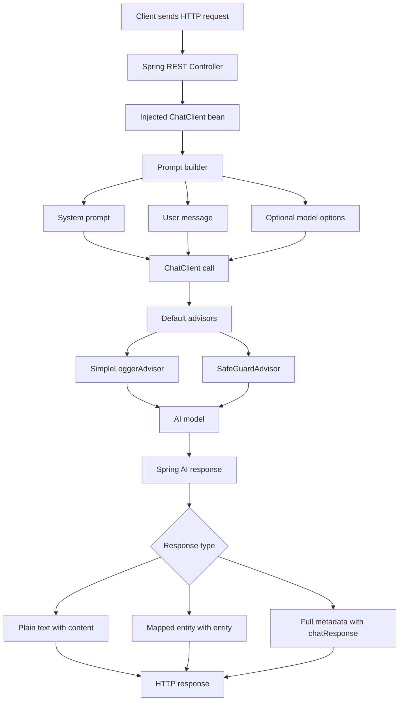

# Gen AI Spring Boot

A Spring Boot REST API for experimenting with generative AI chat integrations through Spring AI and a direct OpenAI HTTP client.

The application currently supports:

- Summarizing text with a Spring AI `ChatClient`
- Summarizing text with a direct Apache HTTP client call to OpenAI
- Drafting professional emails from user input
- Applying token probability controls through an Ollama-backed endpoint
- Returning model output wrapped in a JSON response
- Inspecting AI response details and token usage metadata
- Running local model experiments with Ollama / Docker model endpoints

## Tech Stack

- Java 25
- Spring Boot 4.1.0
- Spring AI 2.0.0
- Maven
- Apache HttpClient 5
- OpenAI-compatible chat APIs
- Ollama

## Project Structure

The main Spring Boot application class is `GenAiSbApplication`.

The `config` package contains `AppConfig`, which creates separate Spring AI chat clients for OpenAI and Ollama models.

The `controller` package contains the REST API controllers for summarization, email drafting, Ollama token probability options, JSON-wrapped responses, and AI response details.

The `client` package contains `OpenAIClientService`, which demonstrates calling the OpenAI chat completions API directly with Apache HttpClient.

The `exception` package contains the custom `OpenAIChatException`.

The `hugging-face` folder contains a helper script for testing Hugging Face summarization, and the `ollama` folder contains a Mistral model manifest reference.

## Spring AI Concepts Used

This project is mainly a Spring AI practice project. It shows different ways to send prompts to AI models, configure model behavior, protect requests with advisors, and inspect model responses.

### Request Flow Diagram

The diagram below shows how a request moves through the application when an endpoint uses Spring AI.



Step by step:

- The client sends a request to one of the REST endpoints.
- The controller uses the injected `ChatClient` bean.
- The prompt is built with optional system instructions, user input, and model options.
- Default advisors run before or around the model call.
- `SimpleLoggerAdvisor` logs chat activity.
- `SafeGuardAdvisor` blocks restricted words such as `password` and `username`.
- The request is sent to the configured AI model.
- The controller chooses how to return the result: plain text, mapped entity, or detailed metadata.

### ChatClient

`ChatClient` is the main Spring AI API used by the controllers.

The project defines two named `ChatClient` beans in `AppConfig`:

- `openAIChatClient` uses `OpenAiChatModel`
- `ollamaAIChatClient` uses `OllamaChatModel`

Controllers inject the correct client with `@Qualifier`. The OpenAI controller uses `openAIChatClient`, while the Ollama controller uses `ollamaAIChatClient`.

The common Spring AI call flow in this project is:

- `chatClient.prompt()` starts a new prompt request
- `.system(...)` adds system instructions for the model
- `.user(...)` adds the user message
- `.options(...)` applies request-level model options when needed
- `.call()` sends the request to the model
- `.content()`, `.entity(...)`, or `.chatResponse()` controls how the response is returned

### Advisors

Spring AI advisors are reusable components that can intercept or decorate chat requests and responses. They are useful for adding cross-cutting behavior without repeating logic in every controller method.

This project configures two advisors in `AppConfig`:

- `SimpleLoggerAdvisor`
- `SafeGuardAdvisor`

Both advisors are registered as default advisors on the OpenAI and Ollama `ChatClient` beans. This means every request made through those clients goes through the advisors automatically.

`SimpleLoggerAdvisor` logs chat request and response activity. The application enables advisor logging in `application.yaml` with `org.springframework.ai.chat.client.advisor: DEBUG`.

`SafeGuardAdvisor` blocks requests that contain restricted words. In this project, the restricted words are `password` and `username`. If a request contains one of those words, the advisor returns `Your request contains restricted information.` instead of sending the prompt normally.

### System Prompts

System prompts define the model behavior before the user message is processed.

The email endpoint uses a system prompt that asks the model to draft professional, concise, clear, and polite emails.

The token probability endpoint uses a system prompt that asks the model to return concise details with fewer tokens.

The JSON response endpoint uses a system prompt that asks the model to return output mapped to the `JsonChatResponse` entity.

### Model Options

The `/v1/api/ollama/chat/ai-revolution` endpoint demonstrates request-level model configuration with `OllamaChatOptions`.

It sets:

- `maxTokens` to `100`
- `topP` to `0.7`
- `topK` to `5`

These options control the length and token selection behavior for that specific request.

### Structured Entity Mapping

The `/v1/api/ollama/chat/json-response` endpoint demonstrates Spring AI structured output mapping.

Instead of manually wrapping a string response, the endpoint calls `.entity(JsonChatResponse.class)`. Spring AI asks the model to produce output that can be mapped into the `JsonChatResponse` Java record.

The request entity is `JsonChatRequest`, which contains a `message` field.

The response entity is `JsonChatResponse`, which contains a `response` field.

### Response Details

The `/v1/api/ollama/chat/response-details` endpoint demonstrates how to inspect the lower-level `ChatResponse`.

It returns useful details such as:

- Generated response text
- Model name
- Response id
- Finish reason
- Content filters
- Tool-call status
- Prompt tokens
- Completion tokens
- Total tokens

This endpoint is useful when learning how Spring AI represents model responses internally.

## Configuration

Application settings live in `src/main/resources/application.yaml`.

The application runs on port `8083`.

The Spring AI OpenAI client is configured with an OpenAI-compatible local base URL at `http://localhost:12434/engines/v1` and uses the `docker.io/ai/gemma3:4b` model.

The Ollama configuration points to `http://localhost:11434` and uses the `mistral:7b` model with a temperature of `0.7`.

The direct OpenAI HTTP client reads the API key from the `OPENAI_API_KEY` environment variable and uses the `gpt-4o` model.

## Run Locally

Start the application with the Maven wrapper. Once running, the API is available at `http://localhost:8083`.

## API Endpoints

### Summarize With Spring AI

The `/v1/api/chat/summarize` endpoint accepts plain text in the request body and returns a model-generated summary using the configured Spring AI `openAIChatClient` bean.

### Summarize With Direct OpenAI HTTP Client

The `/v1/api/chat/summarize-with-openai-with-http-client` endpoint accepts plain text in the request body and sends it to OpenAI through `OpenAIClientService`.

This service builds the chat completions request manually with Apache HttpClient and parses the OpenAI response with Jackson.

### Draft Email

The `/v1/api/ollama/chat/draft-email` endpoint accepts plain text in the request body and returns a professional email draft using the configured Ollama chat client.

It uses a system prompt that asks the model to write clear, polite, concise, and formal emails.

### Ollama Token Probability Options

The `/v1/api/ollama/chat/ai-revolution` endpoint accepts plain text in the request body and returns a concise response using the configured Ollama chat client.

This endpoint uses `OllamaChatOptions` to set `maxTokens` to `100`, `topP` to `0.7`, and `topK` to `5`.

### JSON Response

The `/v1/api/ollama/chat/json-response` endpoint accepts a JSON request body with a `message` field, sends it to the configured Ollama chat client, and maps the AI output directly into a `JsonChatResponse` entity with a `response` field.

### AI Response Details

The `/v1/api/ollama/chat/response-details` endpoint accepts a JSON request body with a `message` field and returns the generated text with response metadata such as model, response id, finish reason, content filters, tool-call status, and token usage.

## Ollama Setup

If you want to use the configured Ollama model, make sure Ollama is running locally and the `mistral:7b` model is available.

The repository also includes `ollama/mistral-manifests.json` as a model manifest reference.

## Open WebUI

Open WebUI can be used as a browser-based interface for local model experiments.

It can be started with Docker using host networking, persistent backend storage, and an Ollama-compatible base URL.

```bash
docker run -d -p 3000:8080 -v open-webui:/app/backend/data -e OLLAMA_BASE_URL=http://localhost:12434/api/tags --name open-webui --restart always ghcr.io/open-webui/open-webui:main
```

## Hugging Face Script

The `hugging-face/hugging-face.sh` script calls the Hugging Face Inference Router with `facebook/bart-large-cnn` for summarization.

It requires the `HUGGINGFACE_API_KEY` environment variable before it can call the Hugging Face API.

## Tests

The project includes a basic Spring Boot context-loading test in `GenAiSbApplicationTests`.

Run the Maven test lifecycle to verify that the application context starts successfully.
